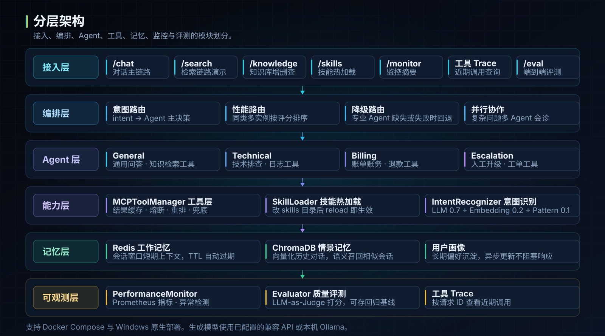
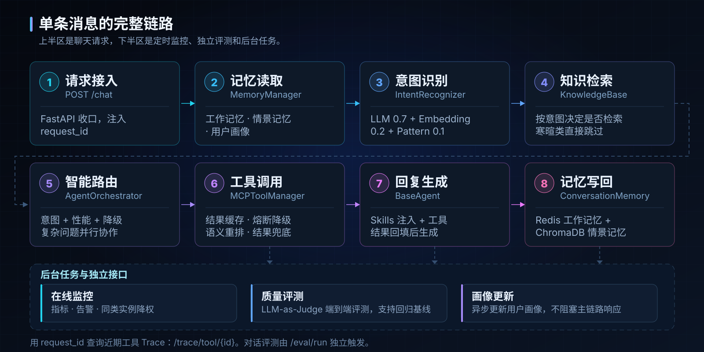
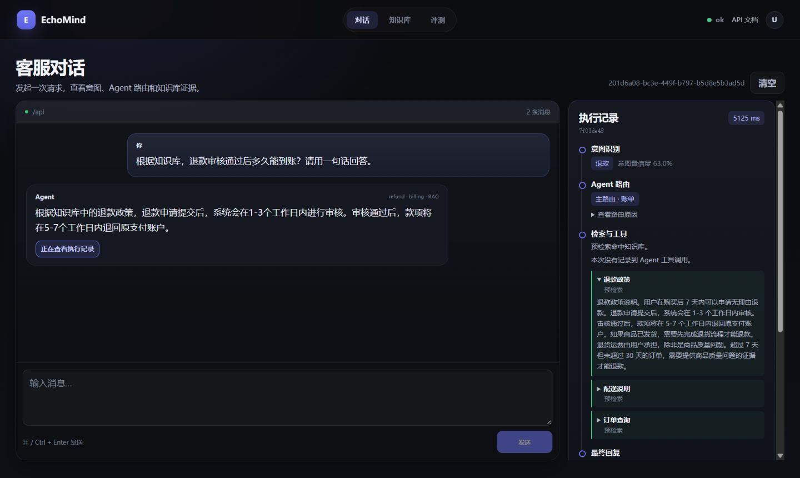
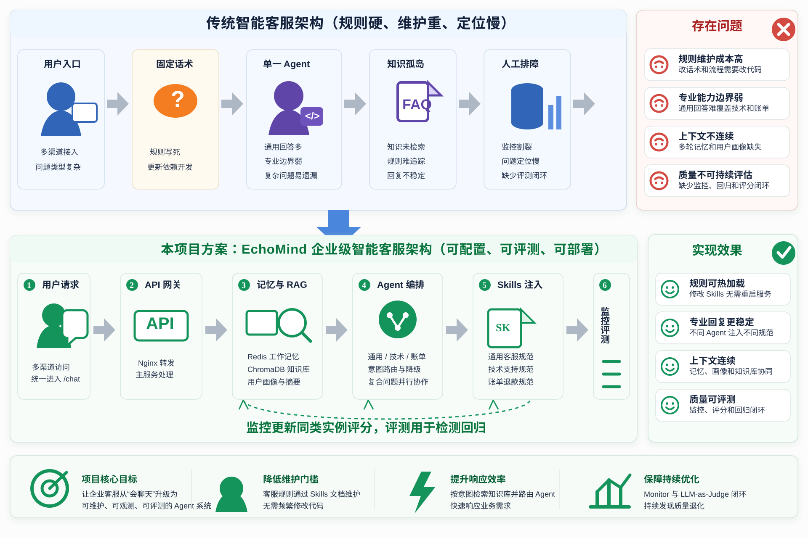
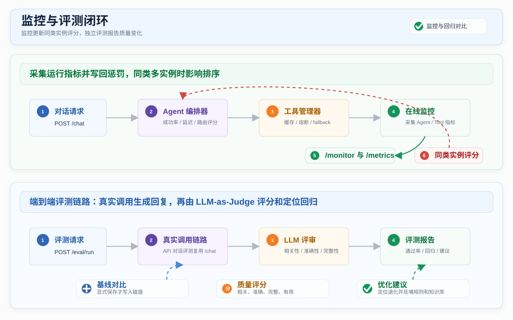

<div align="center">


<br>


<br><br>


</div>

---

一次对话经过 **记忆读取 → 意图识别 → 按意图预检索 → Agent 路由与执行 → 记忆写回**。Agent 执行期间可按需调用工具，监控定时汇总指标，对话评测可通过独立接口触发。

> [`EchoMind学习指南.md`](EchoMind学习指南.md) 提供了按请求链路读代码的 7 天学习路径，以及两个容易理解错的字段口径（`latency_ms`、`knowledge_used`）。

## 核心能力

| 能力 | 实现 | 代码位置 |
|---|---|---|
| 三路融合意图识别 | LLM 0.7 + Embedding 0.2 + Pattern 0.1，输出 intent / urgency / entities | `core/intent_recognizer.py` |
| Agent 路由 | 按领域信号选择主辅 Agent，同类有多个实例时按运行评分选择，专业 Agent 缺失或执行失败时可回退通用 Agent | `agents/agent_orchestrator.py` |
| MCP 风格工具层 | 结果缓存、熔断、语义重排和降级，支持查看近期请求的工具 Trace | `mcp/tool_manager.py` |
| Skills 热加载 | 改 `skills/` 目录后调 `/skills/reload` 即生效，不重启进程 | `core/skill_loader.py` |
| 分层记忆 | Redis 工作记忆（TTL）+ ChromaDB 情景记忆（向量召回）+ 用户画像 | `memory/conversation_memory.py` |
| 可观测 | Prometheus 指标、告警及 Agent 实例级降权。默认每类一个实例，监控降权只影响评分 | `monitor/performance_monitor.py` |
| 可评测 | 标注意图评测、对话 LLM-as-Judge、逐题结果与回归检测 | `evaluation/evaluator.py` |
| 可降级 | 关键模型或工具调用失败时，按路径回退到候选规则、降级提示或通用 Agent | `core/intent_recognizer.py` / `mcp/tool_manager.py` / `agents/agent_orchestrator.py` |

## 分层架构

<div align="center">

</div>

系统按 API 接入、编排、Agent、工具、记忆、监控和评测划分模块。

## 核心链路

<div align="center">

</div>

主要接口包括 `/chat`（对话）、`/search`（检索）、`/knowledge/add|upload|stats`（知识库）、`/skills` 和 `/skills/reload`（查看与热加载 Skills）、`/monitor`（监控摘要）、`/metrics`（指标）、`/trace/tool/{id}`（工具调用记录）以及 `/eval/run`（评测）。

`knowledge_used=true` 表示预检索或 Agent 工具返回了真实知识片段。执行记录可查看片段来源和降级状态。工具 Trace 默认在内存保留最近 200 条请求记录，进程重启后重新累积。

## 运行展示



本地运行示例中，用户询问退款到账时间，账单 Agent 根据命中的《退款政策》回答审核通过后 5–7 个工作日退回原支付账户。右侧执行记录可展开核对原文。

## 快速开始

Windows 可通过本机 Ollama、Redis 和预编译版 ChromaDB 启动 Python 后端与 Vue 调试界面。安装、验证和停止步骤见 [Windows 本地部署](WINDOWS_LOCAL.md)。

### Docker 部署前置条件

- Docker + Docker Compose
- 一个 LLM API Key（Anthropic 官方，或 DeepSeek 等兼容 Anthropic 协议的第三方服务）

### 方式一：启动后端全家桶（API + Redis + ChromaDB + Prometheus + Nginx）

```bash
cd EchoMind
cp .env.example .env      # 编辑 .env，填入 ANTHROPIC_API_KEY
docker compose up -d --build
```

访问入口：

| 服务 | 地址 |
|---|---|
| API / Swagger | `http://localhost:8000`（文档 `/docs`） |
| Nginx 统一入口 | `http://localhost` |
| ChromaDB（宿主机） | `http://localhost:8001` |
| Prometheus | `http://localhost:9090` |
| Redis | `localhost:6379` |

### 方式二：启动前端 + 网关（前端界面 + 后端 + Redis + ChromaDB）

```bash
cd EchoMindFrontend
# 关键：compose 从当前目录 .env 或 shell 环境读取 ANTHROPIC_API_KEY
cp ../EchoMind/.env .env     # 或 export ANTHROPIC_API_KEY=sk-xxx
docker compose up -d --build
```

访问：`http://localhost`（网关入口）或 `http://localhost:5174`（前端容器）。

两套 Compose 共用 Redis 与 ChromaDB 的容器名，并占用相同的宿主机端口（80、8000、8001）。同一台机器上任选一套。

### 第三方模型服务配置（以 DeepSeek 为例）

```env
ANTHROPIC_BASE_URL=https://api.deepseek.com/anthropic
ANTHROPIC_MODEL=deepseek-v4-pro
ANTHROPIC_API_KEY=your_key
```

## 本地开发

### 后端（Python 3.12）

```bash
cd EchoMind
python -m venv .venv && source .venv/bin/activate   # Windows: .venv\Scripts\activate
pip install -r requirements-dev.txt
pytest tests/ -v          # 回归测试用假 LLM + 假 ChromaDB，不访问外部服务
```

- 记忆与知识库在实例初始化时才加载 `chromadb`。离线回归测试使用假存储、假 LLM，可在未安装 ChromaDB 时执行。Windows 原生运行使用 [独立依赖清单](EchoMind/requirements-windows.txt)。
- CLI 调试模式（需本机 Redis 和 API Key）：`python -m api.main --cli`

### 前端（Node 22）

```bash
cd EchoMindFrontend
npm install
npm run dev               # http://localhost:5173，/api 代理到 localhost:8000
# 后端端口不是 8000 时：API_PROXY_TARGET=http://localhost:9000 npm run dev
```

> 若 `npm install` 后 `npm run build` 报 `Cannot find module '@rollup/rollup-win32-x64-msvc'`，是 npm 漏装了 rollup 的平台原生包（`node_modules/@rollup/` 会是空的）。显式补装即可，版本号与本机 rollup 保持一致：
> ```bash
> npm install @rollup/rollup-win32-x64-msvc@<rollup 版本> --no-save
> ```

## 仓库结构

```
EchoMind/
├── assets/                     # 本 README 使用的配图（深色主题）
├── EchoMind/                   # 后端：多 Agent 编排、意图识别、RAG、记忆、监控、评测
│   ├── api/main.py             #   FastAPI 入口，所有接口在此收口
│   ├── agents/                 #   Orchestrator + General/Technical/Billing/Escalation
│   ├── core/                   #   意图识别、LLM 工具、Skills 加载
│   ├── mcp/                    #   知识库 + 工具管理器（缓存/熔断/重排/降级）
│   ├── memory/                 #   分层记忆（Redis + ChromaDB + 画像）
│   ├── monitor/                #   性能监控 + Prometheus + 异常检测
│   ├── evaluation/             #   LLM-as-Judge 评测
│   ├── skills/                 #   可被热加载的技能包
│   ├── tests/                  #   45 passed（离线回归）
│   └── wiki/                   #   全套技术文档 + 架构图
├── EchoMindFrontend/           # Vue 3 + Vite 调试界面
│   └── src/                    #   App.vue、RequestInspector.vue、EvaluationDetails.vue 等
├── Local.ps1                   # Windows 本地服务启动、停止和状态检查
├── WINDOWS_LOCAL.md            # Windows 部署、验证和日志位置
└── EchoMind学习指南.md           # 按请求链路读代码的 7 天路径
```

| 目录 | 内容 | 定位 |
|---|---|---|
| `EchoMind/` | Python/FastAPI 后端 | 核心实现 |
| `EchoMindFrontend/` | Vue 3 + Vite 调试界面：聊天、知识库管理、Skills 热加载、评测、Trace 查看 | 演示界面 |
| `EchoMind学习指南.md` | 按请求链路读代码的 7 天学习路径 | 学习入口 |

## 文档导航

| 文档 | 内容 |
|---|---|
| [`EchoMind/README.md`](EchoMind/README.md) | 后端详解：架构、接口、运行时组件 |
| [`WINDOWS_LOCAL.md`](WINDOWS_LOCAL.md) | Windows 原生部署、真实服务验证与日志位置 |
| [`EchoMindFrontend/README.md`](EchoMindFrontend/README.md) | 前端详解：三种部署模式下 `/api` 的指向 |
| [`EchoMind/wiki/技术亮点.md`](EchoMind/wiki/技术亮点.md) | 关键技术点与设计动机 |
| [`EchoMind/wiki/重点代码.md`](EchoMind/wiki/重点代码.md) | 逐模块代码导读 |
| [`EchoMind/wiki/业务流程说明.md`](EchoMind/wiki/业务流程说明.md) | 业务视角的流程说明 |
| [`EchoMind/wiki/完整使用指南.md`](EchoMind/wiki/完整使用指南.md) | 全功能操作手册 |
| [`EchoMind/2026.08.29改动说明.md`](EchoMind/2026.08.29改动说明.md) | 多 Agent 编排重构记录 |
| [`EchoMind学习指南.md`](EchoMind学习指南.md) | 7 天读码路径 |

### 用工作台演示一条请求

在「对话」点击「查询退款政策」，对照回答和右侧执行记录。面板从 API 和工具 Trace 展示意图、主辅路由、预检索状态和命中片段。点击历史回复下的「查看执行记录」可切回该轮，路由原因和原始回包可按需展开。知识库视图区分真实片段和降级状态，评测视图分开呈现意图标注对照、对话模型评分及异常项。

<details>
<summary><b>架构图集（6 张，展开查看）</b></summary>

<br>

| 整体架构 | 对话链路 |
|---|---|
|  |  |

| Agent 与 Skills | 数据存储 |
|---|---|
|  |  |

| 监控与评测 | 部署拓扑 |
|---|---|
|  |  |

</details>

## 注意事项（跨机移植）

- 后端、前端和文档都在 [ParkChoa6/EchoMind](https://github.com/ParkChoa6/EchoMind) 中维护。[参考仓库](https://github.com/TCcjx/EchoMind)。
- 在新机器上重新安装 Python 和前端依赖。Windows 按 [本地部署指南](WINDOWS_LOCAL.md) 使用独立依赖，Docker 使用各自的 Compose 配置。
- **已知限制**：管理接口无鉴权，本文示例用于本机开发。Docker 的 Redis 默认密码 `echomind123` 为演示值，两套 Compose 会占用相同端口。Windows 原生部署使用单独的 ChromaDB 依赖版本。
- 提交前检查暂存内容。密钥、`.env`、生成的数据、`.runtime/`、虚拟环境和前端依赖留在本地。可用 `.git/info/exclude` 保存个人忽略规则。

---

<div align="center">

**EchoMind** — 可观测、可评测、可降级的多 Agent 客服运行时。

</div>

## 学习体验修正（2026-10-11）

- 聊天回复立即显示，工具 Trace 与监控随后补充，不再延迟显示答案。
- 记忆检索使用 ChromaDB 的 `$and` 条件；压缩保持消息时序，保留摘要期间的新消息。
- `knowledge_used` 只表示真实片段命中，检索降级不再当成知识依据。
- `/metrics` 默认即可获取业务指标：`requests_total{status}` 统计聊天轮次（含对话评测），`chat_latency_ms` 记录逐轮全链路耗时，`agent_avg_latency_ms` 展示累计均值。
- 网页启动的对话评测复用聊天路径，默认使用每次独立的评测用户/会话；直接构造评测器仍可选择仅评测编排器。
- JSON 上传逐项校验，超大文件、错误编码及格式错误给出明确提示；知识导入后清理旧检索缓存。
- Compose 使用 Python 健康检查；代理读取超时为 180 秒，上传请求体上限为 11 MiB（包含 multipart 开销），实际文件上限仍为 10 MiB。

## 验证范围

- **离线回归**覆盖 45 项测试，使用假模型或假存储验证关键分支。Vue 生产构建已通过。
- **Windows 实跑**使用本机 Ollama、Redis 和 ChromaDB，验证了知识导入与检索、两轮对话、主辅 Agent 路由、工具 Trace 查询和重启后数据可读。 [部署与复现步骤](WINDOWS_LOCAL.md)
- **内置评测**包含 11 条意图用例和 5 组对话（共 7 轮），用于检查本地评测链路。默认评测结果可查看逐题明细，显式设置 `save_baseline: true` 才会写入磁盘基线。
- **Docker Compose** 的服务和端口已按配置核对，容器实跑待验证。
